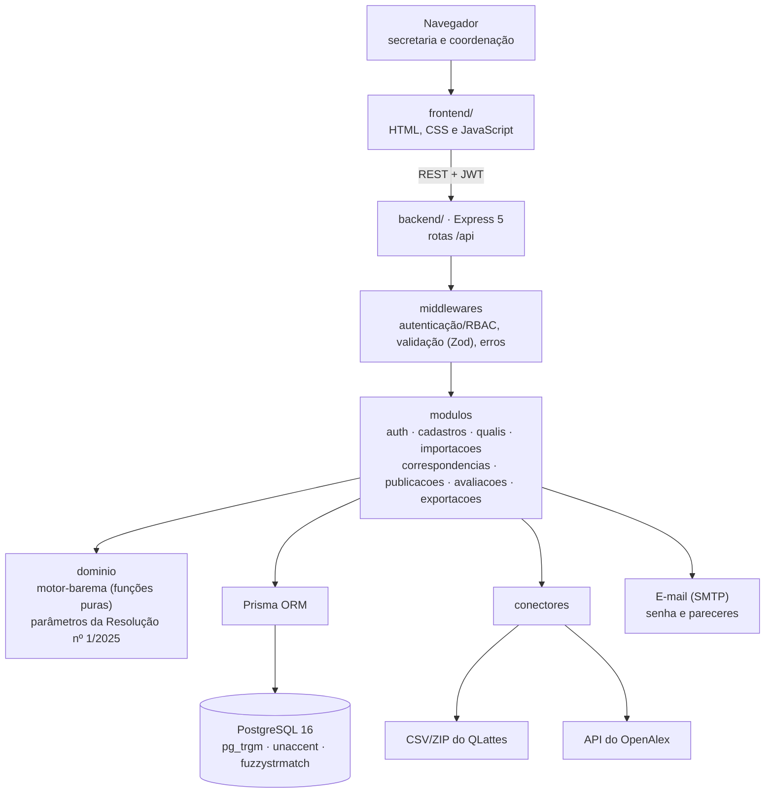
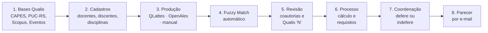

# Barema PPGI - Plataforma de Credenciamento e Recredenciamento de Docentes

[](https://nodejs.org/)
[](https://expressjs.com/)
[](https://www.postgresql.org/)
[](https://www.prisma.io/)
[](https://conventionalcommits.org)
[](https://ic.ufal.br/)

Projeto acadêmico desenvolvido para a disciplina de **Programação 3 (P3)**, no curso de **Bacharelado em Ciência da Computação** do **Instituto de Computação (IC)** da **Universidade Federal de Alagoas (UFAL)**, para o **Programa de Pós-Graduação em Informática (PPGI/UFAL)**.

---

## Sumário

- [1. Visão Geral do Sistema](#1-visão-geral-do-sistema)
- [2. Arquitetura](#2-arquitetura)
- [3. Fluxo de Uso](#3-fluxo-de-uso)
- [4. Regras da Resolução nº 1/2025](#4-regras-da-resolução-nº-12025)
- [5. Fontes de Dados e Fuzzy Match](#5-fontes-de-dados-e-fuzzy-match)
- [6. Requisitos e Status](#6-requisitos-e-status)
- [7. Persistência de Dados](#7-persistência-de-dados)
- [8. Padrão de Versionamento (Conventional Commits)](#8-padrão-de-versionamento-conventional-commits)
- [9. Como Executar](#9-como-executar)
- [10. Como Executar os Testes](#10-como-executar-os-testes)
- [11. Glossário](#11-glossário)
- [12. Equipe e Autoria](#12-equipe-e-autoria)

---

## 1. Visão Geral do Sistema

O credenciamento e o recredenciamento de docentes do **PPGI/UFAL** exigem avaliar a produção científica de cada docente: classificar os artigos pelo **Qualis**, identificar **coautorias** entre docentes do programa, dividir a pontuação entre eles e conferir os **mínimos exigidos** pela **Resolução nº 1/2025**. Hoje esse trabalho é feito à mão, numa planilha, a partir dos currículos Lattes.

A **Plataforma de Baremas** automatiza esse processo, do currículo ao parecer, integrando-se às ferramentas que o programa já usa (como a extensão **QLattes**) em vez de substituí-las.

### Objetivos Principais:
- **Organização dos dados**: docentes, discentes, orientações, disciplinas e produção científica num só lugar, com histórico.
- **Classificação Qualis automática**: periódicos pelo ISSN (CAPES → PUC-RS → Scopus) e eventos pela sigla (Qualis Eventos da Computação), com fila manual para o que não estiver em nenhuma base.
- **Coautorias confiáveis**: o **Fuzzy Match** roda no próprio PostgreSQL e junta publicações iguais vindas de currículos diferentes; os casos duvidosos vão para revisão humana.
- **Cálculo fiel à resolução**: pontuação, divisão entre coautores do PPGI, mínimos de Pesquisa, Orientação e Docência e as exceções (recém-credenciado, subconjunto, teto de colaboradores).
- **Processo rastreável**: abertura individual ou em lote, revisão das publicações consideradas, deferimento pela coordenação e parecer enviado por e-mail.

---

## 2. Arquitetura



> A própria API entrega as telas: tudo roda num endereço só (http://localhost:3000).

### Estrutura

| Pasta | Conteúdo |
|---|---|
| [`backend/prisma`](backend/prisma) | Esquema do banco (`schema.prisma`), migrações (geradas e ajustadas à mão: CHECKs, gatilhos, view) e seed de demonstração |
| [`backend/src/dominio`](backend/src/dominio) | Motor de cálculo da Resolução nº 1/2025 e os parâmetros iniciais |
| [`backend/src/modulos`](backend/src/modulos) | Rotas e serviços por assunto: `auth`, `cadastros`, `qualis`, `importacoes`, `conectores/openalex`, `correspondencias` (Fuzzy Match), `publicacoes`, `avaliacoes`, `exportacoes` |
| [`backend/src/middlewares`](backend/src/middlewares) | Autenticação JWT e perfis, validação, upload e tradução de erros |
| [`backend/scripts`](backend/scripts) | `preparar` (resolução e parâmetros), `criar-usuario`, testes de integração |
| [`backend/test`](backend/test) | Testes de unidade e de integração (PostgreSQL) |
| [`frontend`](frontend) | Telas (`*.html`) e módulos em `assets/js`: `core` (API, carregamento), `domain` (dados), `ui`, `layout`, `pages` |

### Telas

| Tela | O que faz |
|---|---|
| **Painel** | Situação do ciclo: processos em andamento, relatórios a enviar |
| **Docentes / Perfil** | Lista do IC, vínculo com o PPGI, importação do QLattes (.zip ou .csv) e do OpenAlex |
| **Cálculo / Requisitos** | Pontuação por publicação, divisão entre coautores e cada critério (exigido × obtido) |
| **Relatório** | Parecer do docente, impressão em PDF e envio por e-mail |
| **Credenciamento** | Abertura individual ou em lote, com conferência dos requisitos e das coautorias |
| **Revisão** | Coautorias do Fuzzy Match a decidir e veículos sem estrato Qualis |
| **Cadastros** | Docentes, discentes e coorientações, membros externos, disciplinas e turmas, publicação manual |
| **Bases Qualis** | Envio das tabelas, histórico de cargas e consulta do estrato |

---

## 3. Fluxo de Uso



O passo a passo completo está no **[Guia de instalação e uso](GUIA-INSTALACAO.md)**.

---

## 4. Regras da Resolução nº 1/2025

> [!NOTE]
> Os valores abaixo ficam na tabela `parametro` do banco e podem ser ajustados pela coordenação sem novo deploy. As regras estão em [`backend/src/dominio/motor-barema.js`](backend/src/dominio/motor-barema.js), testadas uma a uma.

| Critério | Regra |
|---|---|
| **Pontos por estrato** | A1 = 1,0 · A2 = 0,875 · A3 = 0,75 · A4 = 0,625 · B1 = 0,5 · abaixo de B1 = 0 |
| **Divisão da coautoria** | Pontos do artigo ÷ nº de **docentes do PPGI** entre os autores (discentes e externos não entram no divisor) |
| **Período de Pesquisa** | 36 meses (por padrão, os 3 anos completos anteriores) |
| **Credenciamento** | ≥ 3,5 pontos e ≥ 2 **periódicos** A3 ou superior |
| **Recredenciamento** | ≥ 2,5 pontos, ≥ 1 periódico A4 ou superior e ≥ 1 produção em coautoria com **discente** do PPGI |
| **Orientação** (recred.) | ≥ 2 orientações em andamento ou concluídas em 24 meses; coorientação vale 0,5; teto de 8 orientandos por Permanente |
| **Docência** (recred.) | ≥ 1 disciplina em 24 meses, sem contar **Estudo Dirigido** |

**Exceções e transições**

- **Recém-credenciado** (menos de 24 meses de vínculo): isento de Orientação e Docência.
- **Bloqueio por subconjunto** (Art. 3º, §2º): o credenciamento é negado se toda a produção do candidato também for de um mesmo docente do PPGI.
- **Progressão Colaborador → Permanente** (Art. 3º, §3º): 12 meses de vínculo, 1 publicação com discente e 1 disciplina.
- **Teto de 30% de Colaboradores** (Art. 8º): colaboradores aptos ordenados pela pontuação de Pesquisa.

---

## 5. Fontes de Dados e Fuzzy Match

| Fonte | O que traz | Observação |
|---|---|---|
| **CSV do QLattes** | Artigos em periódicos, com ISSN e estrato | Exportado da extensão QLattes no Currículo Lattes (exige resolver o CAPTCHA). Individual (.csv) ou em lote (.zip, processado em segundo plano). **Não traz eventos, coautores nem DOI.** |
| **OpenAlex** | Periódicos **e eventos**, com **coautores** e DOI | API aberta, sem CAPTCHA. O docente é identificado pelo **ORCID**. Chave gratuita opcional (`OPENALEX_API_KEY`). |
| **Publicação manual** | O que faltar (eventos, coautores discentes ou externos) | Tela Cadastros → Publicação manual. |
| **Tabelas Qualis** | Estrato de periódicos e eventos | CAPES (Sucupira), PUC-RS, Scopus (percentil) e Qualis Eventos da Computação. |

**Fuzzy Match no PostgreSQL** (sem bibliotecas externas), ao fim de cada importação:

1. **DOI idêntico** → nota 100;
2. **mesmo veículo e título igual** (inteiro ou sem o subtítulo) → nota 100;
3. **similaridade de trigramas** do título (`pg_trgm`), entre veículos do mesmo tipo e com ano ±1.

| Nota | O que acontece |
|---|---|
| ≥ 92 | Junta as publicações automaticamente (a pontuação passa a ser dividida) |
| 80 a 91 | Vai para a tela **Revisão** |
| < 80 | Descarta |

Juntar uma publicação é reversível: rejeitar a correspondência, mesmo automática, desfaz a junção.

> [!WARNING]
> **Mudança no site do Lattes (26/11/2026):** o Currículo Lattes passou por uma atualização grande. A extensão QLattes lê a página do currículo, então a importação pelo CSV precisa ser reavaliada. O conector **OpenAlex** e a **publicação manual** não dependem do site do Lattes.

---

## 6. Requisitos e Status

### Requisitos funcionais (Documento de Requisitos V0)

| ID | Funcionalidade | Criticidade | Status |
|---|---|---|---|
| RF01 | Organização dos dados dos docentes usados na avaliação | Alta | ✅ |
| RF02 | Integração com dados do Currículo Lattes | Alta | ✅ (QLattes e OpenAlex) |
| RF03 | Classificação da produção científica via Qualis | Alta | ✅ |
| RF04 | Identificação de coautorias entre docentes do PPGI/UFAL | Alta | ✅ |
| RF05 | Cálculo da pontuação da produção científica | Alta | ✅ |
| RF06 | Divisão da pontuação de artigos em coautoria | Alta | ✅ |
| RF07 | Verificação dos critérios mínimos de produção científica | Alta | ✅ |
| RF08 | Correspondência aproximada (Fuzzy Match) para identificar publicações | Média | ✅ |

### Requisitos não funcionais

| ID | Requisito | Criticidade | Como é atendido |
|---|---|---|---|
| RNF01 | Integração com ferramentas existentes | Alta | Importa o CSV do QLattes; o Fuzzy Match substitui a extensão Find Fuzzy Match dentro do banco |
| RNF02 | Organização e clareza das informações | Alta | Cada critério mostra exigido × obtido e a folga |
| RNF03 | Usabilidade da interface | Média | Telas com validação, mensagens claras e acessibilidade |
| RNF04 | Manutenibilidade e evolução | Média | Módulos por assunto, regras em funções puras, parâmetros no banco, testes automatizados |

### Entregas

- [x] **Banco de dados** a partir do Modelo ER (Prisma + PostgreSQL)
- [x] **API** com autenticação e perfis (secretaria e coordenação)
- [x] **Cargas Qualis** versionadas (CAPES, PUC-RS, Scopus, Eventos)
- [x] **Importação do QLattes** (CSV individual e ZIP em lote, em segundo plano)
- [x] **Fuzzy Match** no PostgreSQL e tela de revisão
- [x] **Motor de cálculo** da Resolução nº 1/2025 e processos avaliativos
- [x] **Exportação** XLSX/CSV e **parecer por e-mail**
- [x] **Front end ligado à API**, com telas de cadastro e de bases Qualis
- [x] **Conector OpenAlex** (eventos e coautores, sem CAPTCHA)
- [x] **Guia de instalação** para o professor responsável
- [ ] Reavaliar a importação pelo QLattes após a **mudança do site do Lattes** (26/11/2026)
- [ ] Calibrar os cortes do Fuzzy Match com a planilha histórica (`Credenciamento2026.xlsx`)
- [ ] Importação da planilha de transição (quando o layout estiver disponível)

---

## 7. Persistência de Dados

- **PostgreSQL 16** com **Prisma ORM**. O esquema nasce do **Modelo ER** (Elmasri & Navathe): especializações em tabela única, a categoria AUTOR (docente, discente ou externo) e o estrato Qualis como entidade fraca do veículo.
- **Migrações versionadas** em [`backend/prisma/migrations`](backend/prisma/migrations). O que o Prisma não expressa foi escrito à mão: restrições `CHECK`, **gatilhos** (só Permanente orienta, máximo de 8 orientandos, orientador não é coorientador), índices parciais, a view `vw_resumo_avaliacao` e a função `fn_normaliza_texto`.
- **Idempotência**: cada importação guarda o hash do arquivo; reenviar não duplica, e reimportar um currículo atualizado só acrescenta, sem apagar o que já foi revisado.
- **Pontos com 4 casas decimais**, para que 0,875 ou 0,625 ÷ 3 não sejam arredondados antes da comparação com os mínimos.
- Detalhes do modelo e de todas as rotas da API: [`backend/README.md`](backend/README.md).

---

## 8. Padrão de Versionamento (Conventional Commits)

O projeto adota a convenção de mensagens de commit do [Conventional Commits](https://www.conventionalcommits.org/pt-br/v1.0.0/):

```text
<tipo>(<escopo>): <descrição no imperativo e em minúsculas>

[corpo opcional detalhando a motivação da alteração]
```

### Fluxo de trabalho

- Cada entrega é feita numa branch `feat/<assunto>` (ou `fix/`, `docs/`) e entra na `main` por **Pull Request**.
- Um PR que parte de outra branch de PR deve ter a **base trocada para `main` antes** de a branch de baixo ser mergeada.
- Escopos usados: `banco`, `api`, `qualis`, `cadastros`, `importacoes`, `fuzzy`, `publicacoes`, `avaliacoes`, `openalex`, `frontend`, `docs`.
- Depois de um `git pull` com migrações novas: `npx prisma migrate deploy` na pasta `backend`.

---

## 9. Como Executar

Passo a passo completo (Windows e Linux), do zero até o primeiro processo: **[GUIA-INSTALACAO.md](GUIA-INSTALACAO.md)**.

Resumo, para quem já tem **Node.js 20+** e **PostgreSQL 14+**:

```bash
cd backend
npm install
cp .env.example .env              # ajuste DATABASE_URL e JWT_SECRET
npx prisma migrate deploy
npm run preparar                  # Resolução nº 1/2025 e parâmetros
npm run criar-usuario -- --email voce@ic.ufal.br --nome "Seu Nome" --perfil COORDENACAO
npm start                         # http://localhost:3000
```

> [!TIP]
> Para uma **demonstração** com dados fictícios, use `npx prisma db seed` no lugar de `preparar` e `criar-usuario` (o seed apaga o que houver no banco). Usuários: `secretaria@ic.ufal.br` e `coordenacao@ic.ufal.br`, senha `ppgi2026`.

---

## 10. Como Executar os Testes

Todos os comandos rodam na pasta [`backend`](backend/).

### 10.1 Testes de unidade (sem banco)

```bash
npm test
```

Motor de cálculo (cada regra da resolução), leitores de CSV (QLattes e Qualis), mapeamento do OpenAlex, autenticação e parâmetros. Usam um Prisma em memória.

### 10.2 Testes de integração (PostgreSQL)

```bash
npm run test:integracao
```

Rodam no banco indicado por `DATABASE_URL_TESTE`, **que é apagado a cada execução** (nunca use o banco de produção). O script aplica as migrações e cobre cadastros, cargas Qualis, importação do QLattes, Fuzzy Match, publicações manuais, cálculo e processos, exportações e o conector OpenAlex (com a API simulada).

| Suíte | Testes |
|---|---|
| Unidade (`npm test`) | 57 |
| Integração (`npm run test:integracao`) | 51 |

---

## 11. Glossário

| Termo | Definição |
|---|---|
| **Barema** | Tabela de critérios e pontos usada para avaliar a produção dos docentes. |
| **Credenciamento** | Entrada de um docente no PPGI, como Permanente ou Colaborador. |
| **Recredenciamento** | Renovação periódica do vínculo de quem já está no PPGI. |
| **Permanente / Colaborador** | Categorias de docente do PPGI. Só o Permanente orienta como orientador principal; Colaboradores têm teto de 30%. |
| **Qualis / Estrato** | Classificação de periódicos e eventos da CAPES (A1 a C). "N" = não classificado. |
| **ISSN / Sigla** | Identificador de um periódico / abreviação de um evento (ex.: SBBD), usados para achar o estrato. |
| **QLattes** | Extensão de navegador que classifica os artigos no Currículo Lattes e exporta um CSV. |
| **OpenAlex / ORCID** | Base aberta de produção científica / identificador único de pesquisador, usado para achar o docente no OpenAlex. |
| **Fuzzy Match** | Correspondência aproximada: reconhece a mesma publicação mesmo com pequenas diferenças no título. |
| **Coautoria** | Publicação com mais de um autor; entre docentes do PPGI, a pontuação é dividida. |
| **Recém-credenciado** | Docente com menos de 24 meses de vínculo, isento de Orientação e Docência. |
| **Estudo Dirigido** | Disciplina que não conta para o critério de Docência. |

---

## 12. Equipe e Autoria

**Equipe**

- **Anna Beatriz Bernardo Gomes** — Tech Lead ([@nanameetscode](https://github.com/nanameetscode))
- **Magdiel Santos** — Analista de Requisitos ([@eumagd](https://github.com/eumagd))
- **Mariana Lessa** — Scrum Master ([@lessamariana](https://github.com/lessamariana))

**Professores:** Dr. Ranilson Paiva e Dra. Maria Cristina Tenório

**Stakeholders**

- **Rian Gabriel Santos Pinheiro** — responsável pela condução do processo avaliativo
- **Bruno Costa e Silva Nogueira** — Coordenação do PPGI/UFAL
- Colegiado e docentes do Programa de Pós-Graduação em Informática

Instituto de Computação (IC) — **Universidade Federal de Alagoas (UFAL)**.
