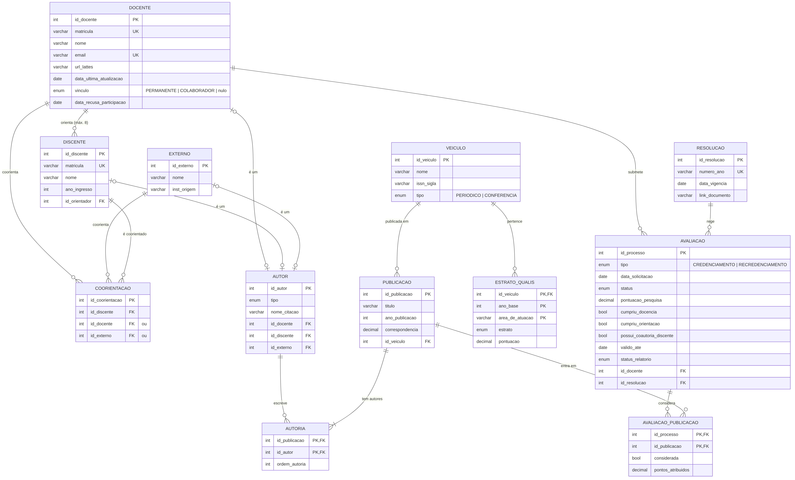

# Banco de dados — Plataforma de Gerenciamento de Baremas (PPGI/UFAL)

> Parte do projeto **Plataforma de Apoio ao Credenciamento e Recredenciamento de Docentes do PPGI/UFAL**.
> Contexto geral no [README da raiz](../README.md). O front end está em [`../frontend`](../frontend).

O banco foi construído **a partir do Modelo ER (Sprint 7)**, feito com base em Elmasri & Navathe.
Usamos o **Prisma ORM** sobre **PostgreSQL**: o esquema é descrito em `prisma/schema.prisma`, o Prisma
gera a migração inicial e, depois, fizemos as **alterações e adaptações necessárias para o projeto**
numa migração manual.

## Como executar

Pré-requisitos: Node.js 18+ e PostgreSQL 14+ (ou Docker).

```bash
cd backend
npm install
cp .env.example .env          # ajuste DATABASE_URL se não usar o Docker
npm run db:up                 # sobe o PostgreSQL pelo Docker (opcional)
npx prisma migrate dev        # aplica as migrações (init + ajustes manuais)
npx prisma db seed            # dados de demonstração (mesmos do front end)
npx prisma studio             # abre o navegador de dados
```

## Do Modelo ER para o banco

| Modelo ER | No banco |
| --- | --- |
| DOCENTE com especialização parcial e disjunta (PERMANENTE, COLABORADOR) | Tabela única `docente` com a coluna `vinculo`; nulo = docente do IC sem vínculo com o PPGI |
| DISCENTE, EXTERNO | Tabelas `discente` e `externo` |
| Orienta (PERMANENTE 1 : N DISCENTE, máx. 8) | Chave estrangeira `discente.id_orientador` + gatilho que valida vínculo e limite |
| Coorienta (M : N) | Tabela `coorientacao`, com um docente **ou** um externo |
| Categoria AUTOR (união de DOCENTE, DISCENTE e EXTERNO) | Tabela `autor` com chave substituta e referência a exatamente uma superclasse |
| Escreve (AUTOR M : N PUBLICACAO, com `ordem_autoria`) | Tabela `autoria` |
| VEICULO com especialização (PERIODICO, CONFERENCIA) | Tabela única `veiculo` com a coluna `tipo` |
| ESTRATO_QUALIS (entidade fraca, Pertence) | Tabela `estrato_qualis`, chave (`id_veiculo`, `ano_base`, `area_de_atuacao`) |
| Publicada Em (N : 1) | `publicacao.id_veiculo` |
| AVALIACAO com especialização (CREDENCIAMENTO, RECREDENCIAMENTO) | Tabela única `avaliacao` com a coluna `tipo`; atributos específicos ficam nulos quando não se aplicam |
| Submete (DOCENTE 1 : N AVALIACAO), Regida Por (N : 1 RESOLUCAO) | `avaliacao.id_docente`, `avaliacao.id_resolucao` |
| RESOLUCAO | Tabela `resolucao` |



O mesmo diagrama em texto está em [`modelo-logico.mmd`](modelo-logico.mmd) (o GitHub renderiza Mermaid).

## O que o framework gerou e o que adaptamos

**Gerado pelo Prisma** (`prisma/migrations/20261111120000_init`): tipos enumerados, tabelas, chaves primárias,
chaves estrangeiras com as ações `ON DELETE`, índices e restrições de unicidade.

**Ajustado à mão** (`prisma/migrations/20261111120500_ajustes_manuais`), porque o Prisma não expressa:

1. **Restrições `CHECK`** de domínio: anos válidos, pontuação não negativa, correspondência entre 0 e 100,
   `ordem_autoria >= 1`, relatório enviado exige data de envio, validade só em processo deferido.
2. **Categoria AUTOR**: cada autor aponta para exatamente uma superclasse, coerente com `tipo`.
3. **Coorienta**: exatamente um coorientador (docente ou externo), sem pares repetidos (índices únicos parciais).
4. **Orienta**: gatilho que só aceita orientador PERMANENTE e no máximo 8 orientandos; outro gatilho impede
   que o orientador também seja coorientador do mesmo discente.
5. **E-mails únicos** sem diferenciar maiúsculas de minúsculas.
6. **View `vw_resumo_avaliacao`**: publicações consideradas, desmarcadas e pontos por processo.

**Adaptações ao projeto** (decisões de modelagem, além do ER):

- Tabela `avaliacao_publicacao`: registra quais publicações entraram em cada avaliação, se a coautoria foi
  desmarcada na revisão manual (RF13) e os pontos após a divisão entre coautores (RF06).
- `docente.data_recusa_participacao`: sinalização de não participação no ciclo (RF16).
- `avaliacao.status`, `valido_ate`, `status_relatorio`: acompanham os estados que o front end já exibe.
- `autor.nome_citacao` e `publicacao.correspondencia`: apoio ao Fuzzy Match (RF08).
- Tabela `usuario`: login da secretaria e da coordenação, com senha guardada como hash.

## Estrutura

```
backend/
├── prisma/
│   ├── schema.prisma                         esquema (modelo do Prisma)
│   ├── seed.js                               dados de demonstração
│   └── migrations/
│       ├── 20261111120000_init/              gerada pelo Prisma
│       └── 20261111120500_ajustes_manuais/   CHECKs, gatilhos, índices parciais e view
├── modelo-logico.mmd / modelo-logico.png     diagrama do modelo lógico
├── docker-compose.yml                        PostgreSQL 16 para desenvolvimento
├── .env.example
└── package.json
```

## Próximos passos

- Cadastro de disciplinas e turmas (critério de docência, RF09 do levantamento) — ainda não está no ER.
- Importação do CSV do QLattes para `publicacao`, `autor` e `autoria`.
- API do back end consumindo este banco e substituindo o `localStorage` do front end.
