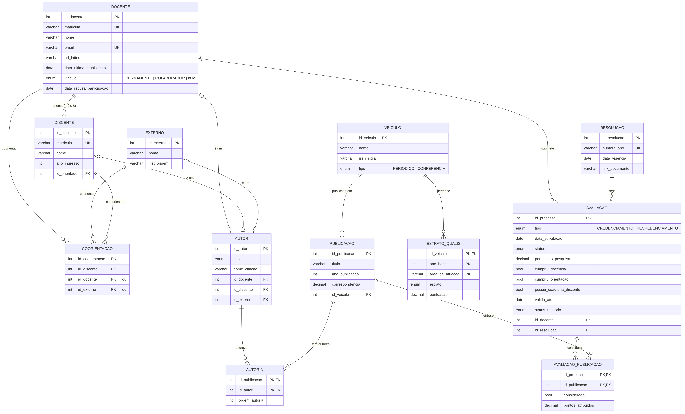

# Banco de dados — Plataforma de Gerenciamento de Baremas (PPGI/UFAL)

> Parte do projeto **Plataforma de Apoio ao Credenciamento e Recredenciamento de Docentes do PPGI/UFAL**.
> Contexto geral no [README da raiz](../README.md). O front end está em [`../frontend`](../frontend).

O banco foi construído **a partir do Modelo ER (Sprint 7)**, feito com base em Elmasri & Navathe.
Usamos o **Prisma ORM** sobre **PostgreSQL**: o esquema é descrito em `prisma/schema.prisma`, o Prisma
gera a migração inicial e, depois, fizemos as **alterações e adaptações necessárias para o projeto**
numa migração manual.

## Como executar

Pré-requisitos: Node.js 20+ e PostgreSQL 14+ (ou Docker). O banco precisa das extensões `pg_trgm`, `unaccent` e `fuzzystrmatch` (já vêm na imagem `postgres:16`).

```bash
cd backend
npm install
cp .env.example .env          # ajuste DATABASE_URL se não usar o Docker
npm run db:up                 # sobe o PostgreSQL pelo Docker (opcional)
npx prisma migrate dev        # aplica as migrações (init + ajustes manuais)
npx prisma db seed            # dados de demonstração (mesmos do front end)
npx prisma studio             # abre o navegador de dados
npm run dev                   # sobe a API em http://localhost:3000
npm test                      # testes de unidade (não precisam de banco)
npm run test:integracao       # testes contra o PostgreSQL, no banco DATABASE_URL_TESTE (é apagado!)
```

Já tem um PostgreSQL instalado na porta 5432? Use o dele (crie o usuário `ppgi` e o banco `barema_ppgi`)
ou ponha `DB_PORT=5433` no `.env` (e a mesma porta na `DATABASE_URL`) para o do Docker não conflitar.
Com npm 11.20 ou mais novo, os scripts de instalação ficam bloqueados; o `postinstall` roda
`prisma generate`, e se o cliente não for gerado, rode `npx prisma generate`.

Usuários do seed: `secretaria@ic.ufal.br` e `coordenacao@ic.ufal.br`, senha `ppgi2026`.

## API

Respostas de erro seguem sempre o formato `{ "erro": { "codigo", "mensagem", "detalhes?" } }`.
Rotas autenticadas exigem o cabeçalho `Authorization: Bearer <token>` devolvido no login.

| Rota | Acesso | O que faz |
| --- | --- | --- |
| `GET /api/saude` | público | Verifica a API e a conexão com o banco |
| `POST /api/auth/login` | público | `{ email, senha }` → `{ token, usuario }` |
| `GET /api/auth/eu` | autenticado | Usuário da sessão |
| `POST /api/auth/recuperar-senha` | público | Envia link de redefinição (responde 202 com ou sem cadastro) |
| `POST /api/auth/redefinir-senha` | público | `{ token, senha }`; o link vale 60 min e uma única vez |
| `GET /api/resolucoes` | autenticado | Resoluções cadastradas |
| `GET /api/resolucoes/:id/parametros` | autenticado | Pesos por estrato, mínimos e cortes do Fuzzy Match |
| `PUT /api/resolucoes/:id/parametros/:chave` | coordenação | `{ valor }`, validado por chave |
| `POST /api/qualis/cargas` | autenticado | Multipart: `arquivo` (.csv), `fonte` (`CAPES`, `PUC_RS`, `SCOPUS`, `EVENTOS`), `ano_base`, `area`? |
| `GET /api/qualis/cargas` | autenticado | Histórico das cargas, com contagens e erros por linha |
| `GET /api/qualis/veiculos` | autenticado | `?busca=&tipo=&area=`: estratos por fonte e o vigente |
| `GET/POST /api/docentes`, `GET/PATCH /api/docentes/:id` | autenticado | Cadastro; o POST cria também o registro em AUTOR |
| `DELETE /api/docentes/:id` | coordenação | Recusa se houver avaliações |
| `POST /api/docentes/:id/desvincular` | autenticado | Tira do PPGI e devolve o vínculo anterior (para "desfazer") |
| `PUT/DELETE /api/docentes/:id/recusa` | autenticado | Sinaliza/desfaz a não participação no ciclo (RF16) |
| `POST/DELETE /api/docentes/:id/nomes-citacao` | autenticado | Variações do nome de citação (RF-BE09) |
| `/api/discentes` (+ `/:id/coorientacoes`) | autenticado | CRUD, orientador, defesa e coorientações |
| `/api/externos` | autenticado | Membros externos (coorientadores e coautores) |
| `/api/disciplinas`, `/api/turmas` | autenticado | Critério de Docência; "Estudo Dirigido" é marcado sozinho |
| `POST /api/importacoes` | autenticado | Multipart: `arquivo` (.csv do QLattes + `id_docente`, ou .zip com vários .csv), `confirmar_nome`? |
| `GET /api/importacoes`, `GET /api/importacoes/:id` | autenticado | Histórico das importações de currículo, com contagens e erros por linha |
| `GET /api/docentes/:id/publicacoes` | autenticado | `?inicio=&fim=` (anos): produção com estrato vigente, fonte e coautores |
| `GET /api/qualis/pendentes` | autenticado | Fila manual: periódicos com publicações e sem estrato em nenhuma base |
| `POST /api/qualis/classificacoes` | autenticado | `{ id_veiculo, estrato, justificativa }` → estrato com fonte `MANUAL` |
| `GET /api/correspondencias` | autenticado | `?faixa=revisao\|automatica\|decididas\|todas&id_docente=`: pares do Fuzzy Match |
| `PATCH /api/correspondencias/:id` | autenticado | `{ decisao: CONFIRMADA\|REJEITADA, justificativa? }`: confirmar mescla; rejeitar desfaz |
| `POST /api/correspondencias/processar` | autenticado | Roda o Fuzzy Match na base toda (ex.: depois de mudar os cortes) |
| `GET /api/autores` | autenticado | `?busca=&tipo=DOCENTE\|DISCENTE\|EXTERNO`: para escolher coautores |
| `POST /api/publicacoes` | autenticado | Cadastro manual (eventos, coautores): `{ titulo, ano, doi?, veiculo, autores: [id_autor] }` |
| `GET/PATCH/DELETE /api/publicacoes/:id` | autenticado | Detalhe, edição e exclusão (recusada se já entrou numa avaliação) |
| `POST/DELETE /api/publicacoes/:id/autores` | autenticado | Acrescenta ou retira coautores (ex.: o discente do recredenciamento) |
| `GET /api/docentes/:id/calculo` | autenticado | `?tipo=&inicio=&fim=&referencia=`: cálculo ao vivo com todos os critérios (nada é gravado) |
| `GET /api/avaliacoes` | autenticado | `?status=&tipo=&id_docente=`: resumo dos processos (`vw_resumo_avaliacao`) |
| `GET /api/avaliacoes/:id` | autenticado | Processo + cálculo, respeitando as publicações desmarcadas |
| `POST /api/avaliacoes`, `POST /api/avaliacoes/lote` | autenticado | Abre o processo (individual ou em lote) e grava o cálculo |
| `POST /api/avaliacoes/:id/recalcular` | autenticado | Refaz o cálculo de um processo em andamento |
| `PATCH /api/avaliacoes/:id/publicacoes/:idPublicacao` | autenticado | `{ considerada }`: desmarca/remarca uma publicação (RF13) |
| `PATCH /api/avaliacoes/:id` | coordenação* | `{ status, valido_ate?, vinculo? }`; *cancelar, qualquer perfil |
| `GET /api/avaliacoes/teto-colaboradores` | autenticado | Ranking do teto de 30% de Colaboradores (Art. 8º) |
| `GET/POST /api/avaliacoes/:id/relatorio` | autenticado | Parecer em texto e HTML; o POST marca o relatório como gerado |
| `POST /api/avaliacoes/:id/relatorio/enviar` | autenticado | `{ para? }`: envia o parecer por e-mail (processo já tramitado) |
| `GET /api/importacoes/lotes/:id` | autenticado | Andamento de um `.zip` (o POST devolve 202 e processa em segundo plano) |
| `GET /api/exportacoes/producao.xlsx` ou `.csv` | autenticado | `?inicio=&fim=&id_docente=`: produção com estrato, fonte, peso, divisor e pontos |
| `GET /api/exportacoes/avaliacoes.xlsx` ou `.csv` | autenticado | `?status=&tipo=`: resumo dos processos |

Perfis (RNF-BE07): **SECRETARIA** conduz o processo (importações, cadastros, revisão); **COORDENACAO**
pode tudo isso e também altera os parâmetros da resolução.

Sem `SMTP_HOST` no `.env`, os e-mails (ex.: link de redefinição) aparecem só no console da API.

### Importação do QLattes

No currículo Lattes (depois de resolver o CAPTCHA), abra a visualização do QLattes, escolha o CV e
clique em **Exportar dados**. O arquivo (`nome_do_docente.csv`) tem uma linha por **artigo em periódico**:

```
nome,lattes_url,ano_publicacao,titulo_publicacao,periodico,issn,qualis,pontos,area,ano_base
```

- **Individual:** envie o `.csv` com o `id_docente`. O ID Lattes da URL é conferido com o cadastro
  (e gravado nele na primeira importação); se o docente ainda não tem ID e o nome não bate, a API pede
  `confirmar_nome=true`.
- **Lote:** um `.zip` com vários `.csv`; cada arquivo é casado pelo ID Lattes ou, na falta dele, pelo
  nome. A resposta (207) diz o resultado de cada arquivo.
- **Idempotente:** o mesmo arquivo não é reprocessado; um CSV atualizado só acrescenta publicações e
  nunca apaga autorias.
- O estrato que o QLattes já calculou é guardado com a fonte deduzida do `ano_base` ("quadriênio
  2017-2020" → CAPES, "2021" → PUC-RS, "2020" → Scopus), mas as tabelas carregadas no servidor prevalecem.
- Artigos iguais (título normalizado + ano + periódico) em CVs de docentes diferentes viram uma única
  publicação com as duas autorias: é assim que a coautoria entre docentes aparece.

**Limites do CSV do QLattes** (conferidos no código da versão 0.2.2): ele **não exporta eventos,
lista de coautores nem DOI**. Para isso existe o **cadastro manual** (`/api/publicacoes`):

- **Artigo em evento:** `veiculo: { "tipo": "CONFERENCIA", "sigla": "SBBD", "nome": "..." }`. O estrato
  vem da tabela Qualis Eventos pela sigla.
- **Coautor discente ou externo:** `POST /api/publicacoes/:id/autores { id_autor }`, com o autor
  achado em `GET /api/autores?busca=`.
- Cadastros manuais também passam pelo Fuzzy Match; um DOI já existente é tratado como a mesma
  publicação (mescla com nota 100).

### Fuzzy Match

Roda no PostgreSQL (`pg_trgm` + `unaccent`) ao fim de cada importação, comparando a produção do
docente com o resto da base. Cada par recebe uma nota de 0 a 100:

1. **DOI idêntico** → 100;
2. **mesmo veículo e título igual** (inteiro ou sem o subtítulo após `:`) → 100;
3. **similaridade de trigramas do título**, só entre veículos do mesmo tipo e com **ano ±1**.

Com os cortes da tabela `parametro` (padrão **92** e **80**): ≥ 92 mescla automaticamente; de 80 a 91
vai para a fila de revisão; abaixo de 80, descarta. Publicações que já têm um autor em comum não são
comparadas (no mesmo CV, títulos parecidos costumam ser obras diferentes).

**Mesclar** move as autorias da publicação mais nova para a mais antiga e marca a nova com
`id_mesclada_em` (ela some da produção). O que foi movido fica guardado na correspondência, então
**rejeitar uma mescla, mesmo automática, a desfaz**. Reprocessar respeita as decisões já tomadas.

Os cortes ainda **não foram calibrados** com a planilha histórica (`Credenciamento2026.xlsx`): ajuste-os
com `PUT /api/resolucoes/:id/parametros/fuzzy.corte_confirmacao` (e `fuzzy.corte_revisao`) e rode
`POST /api/correspondencias/processar`.

### Motor de cálculo (Resolução nº 1/2025)

As regras ficam em `src/dominio/motor-barema.js`, como funções puras (testadas uma a uma em
`test/motor-barema.test.js`); os números vêm da tabela `parametro`.

| Critério | Regra |
| --- | --- |
| Pontos do artigo | peso do estrato (A1 1,0 · A2 0,875 · A3 0,75 · A4 0,625 · B1 0,5 · abaixo 0) ÷ nº de docentes **do PPGI** entre os autores (o avaliado sempre conta; discentes e externos não) |
| Período de Pesquisa | 36 meses; por padrão os 3 anos completos anteriores à data de referência (`?inicio=&fim=` muda) |
| Credenciamento | ≥ 3,5 pontos e ≥ 2 **periódicos** A3 ou superior; bloqueado se toda a produção também for de um mesmo docente do PPGI (Art. 3º, §2º) |
| Recredenciamento | ≥ 2,5 pontos, ≥ 1 periódico A4 ou superior e ≥ 1 produção com discente do PPGI |
| Orientação (recred.) | ≥ 2 em andamento ou concluídas nos últimos 24 meses; coorientação vale 0,5; teto de 8 em andamento |
| Docência (recred.) | ≥ 1 disciplina nos últimos 24 meses, sem "Estudo Dirigido" (níveis em `docencia.niveis`, padrão só pós-graduação) |
| Recém-credenciado | vínculo há menos de 24 meses: isento de Orientação e Docência |
| Colaborador → Permanente | 12 meses de vínculo + 1 publicação com discente + 1 disciplina (informado em `progressao`) |
| Teto de Colaboradores | colaboradores aptos ordenados pela Pesquisa; entram até ⌊30% × (permanentes aptos + colaboradores aptos)⌋ |

Ao abrir um processo, o cálculo é gravado (`avaliacao` e `avaliacao_publicacao`); desmarcar uma
publicação recalcula. Deferir um credenciamento exige o vínculo (Permanente/Colaborador), que passa a
valer no cadastro do docente. Os pontos são guardados com 4 casas decimais.

### Bases Qualis

Cada base é um CSV (exporte a planilha como CSV; UTF-8 ou Latin-1, separado por `;`, `,` ou tab).
Os nomes das colunas são reconhecidos sem acento ou maiúsculas:

| Fonte | Colunas |
| --- | --- |
| `CAPES` (Sucupira) | `ISSN`, `Título`, `Área de Avaliação`, `Estrato` (só a área pedida é importada) |
| `PUC_RS` | `ISSN`, `eISSN`?, `Título`, `Estrato` |
| `SCOPUS` | `ISSN`, `eISSN`?, `Título`, `Percentil` (A1 ≥ 87,5; A2 ≥ 75; ... ; B4 < 12,5) ou `Estrato` |
| `EVENTOS` (Qualis Eventos da Computação) | `Sigla`, `Nome`, `Estrato` |

Uma nova carga substitui a anterior da mesma fonte, ano-base e área; reenviar o mesmo arquivo não
duplica nada. O estrato vigente de um veículo segue a ordem CAPES → PUC-RS → Scopus (o manual fica por
último) e, dentro da fonte, o ano-base mais recente.

## Do Modelo ER para o banco

| Modelo ER | No banco |
| --- | --- |
| DOCENTE com especialização parcial e disjunta (PERMANENTE, COLABORADOR) | Tabela única `docente` com a coluna `vinculo`; nulo = docente do IC sem vínculo com o PPGI |
| DISCENTE, EXTERNO | Tabelas `discente` e `externo` |
| Orienta (PERMANENTE 1 : N DISCENTE, máx. 8) | Chave estrangeira `discente.id_orientador` + gatilho que valida vínculo e limite |
| Coorienta (M : N) | Tabela `coorientacao`, com um docente **ou** um externo |
| Categoria AUTOR (união de DOCENTE, DISCENTE e EXTERNO) | Tabela `autor` com chave substituta e referência a exatamente uma superclasse |
| Escreve (AUTOR M : N PUBLICACAO, com `ordem_autoria`) | Tabela `autoria` |
| VEICULO com especialização (PERIODICO, CONFERENCIA) | Tabela única `veiculo` com a coluna `tipo` |
| ESTRATO_QUALIS (entidade fraca, Pertence) | Tabela `estrato_qualis`, chave (`id_veiculo`, `ano_base`, `area_de_atuacao`) |
| Publicada Em (N : 1) | `publicacao.id_veiculo` |
| AVALIACAO com especialização (CREDENCIAMENTO, RECREDENCIAMENTO) | Tabela única `avaliacao` com a coluna `tipo`; atributos específicos ficam nulos quando não se aplicam |
| Submete (DOCENTE 1 : N AVALIACAO), Regida Por (N : 1 RESOLUCAO) | `avaliacao.id_docente`, `avaliacao.id_resolucao` |
| RESOLUCAO | Tabela `resolucao` |



O mesmo diagrama em texto está em [`modelo-logico.mmd`](modelo-logico.mmd) (o GitHub renderiza Mermaid).

## O que o framework gerou e o que adaptamos

**Gerado pelo Prisma** (`prisma/migrations/20261111120000_init`): tipos enumerados, tabelas, chaves primárias,
chaves estrangeiras com as ações `ON DELETE`, índices e restrições de unicidade.

**Ajustado à mão** (`prisma/migrations/20261111120500_ajustes_manuais`), porque o Prisma não expressa:

1. **Restrições `CHECK`** de domínio: anos válidos, pontuação não negativa, correspondência entre 0 e 100,
   `ordem_autoria >= 1`, relatório enviado exige data de envio, validade só em processo deferido.
2. **Categoria AUTOR**: cada autor aponta para exatamente uma superclasse, coerente com `tipo`.
3. **Coorienta**: exatamente um coorientador (docente ou externo), sem pares repetidos (índices únicos parciais).
4. **Orienta**: gatilho que só aceita orientador PERMANENTE e no máximo 8 orientandos; outro gatilho impede
   que o orientador também seja coorientador do mesmo discente.
5. **E-mails únicos** sem diferenciar maiúsculas de minúsculas.
6. **View `vw_resumo_avaliacao`**: publicações consideradas, desmarcadas e pontos por processo.

**Adaptações ao projeto** (decisões de modelagem, além do ER):

- Tabela `avaliacao_publicacao`: registra quais publicações entraram em cada avaliação, se a coautoria foi
  desmarcada na revisão manual (RF13) e os pontos após a divisão entre coautores (RF06).
- `docente.data_recusa_participacao`: sinalização de não participação no ciclo (RF16).
- `avaliacao.status`, `valido_ate`, `status_relatorio`: acompanham os estados que o front end já exibe.
- `autor.nome_citacao` e `publicacao.correspondencia`: apoio ao Fuzzy Match (RF08).
- Tabela `usuario`: login da secretaria e da coordenação, com senha guardada como hash.

## Estrutura

```
backend/
├── src/
│   ├── app.js / server.js                    montagem do Express e ponto de entrada
│   ├── config.js / db.js                     variáveis de ambiente e Prisma Client
│   ├── dominio/                              regras da Resolução nº 1/2025 (motor de cálculo e parâmetros)
│   ├── lib/                                  erros, hash de senha, e-mail
│   ├── middlewares/                          autenticação/RBAC, validação (Zod), erros, limite de tentativas
│   └── modulos/                              auth, parametros, qualis, cadastros, importacoes, correspondencias, publicacoes, avaliacoes, exportacoes
├── test/                                     unidade (Prisma em memória) e integracao/ (PostgreSQL)
├── scripts/testar-integracao.js              migra o banco de teste e roda test/integracao
├── prisma/
│   ├── schema.prisma                         esquema (modelo do Prisma)
│   ├── seed.js                               dados de demonstração
│   └── migrations/
│       ├── 20261111120000_init/              gerada pelo Prisma
│       ├── 20261111120500_ajustes_manuais/   CHECKs, gatilhos, índices parciais e view
│       ├── 20261124120000_integracao_qlattes/       gerada pelo Prisma (+ extensões)
│       └── 20261124120500_integracao_ajustes_manuais/  normalização de texto, CHECKs, dados
├── modelo-logico.mmd / modelo-logico.png     diagrama do modelo lógico
├── docker-compose.yml                        PostgreSQL 16 para desenvolvimento
├── .env.example
└── package.json
```

## Próximos passos

- Calibrar os cortes do Fuzzy Match com a planilha histórica.
- Importação da planilha de transição (`Credenciamento2026.xlsx`), quando o layout estiver disponível.
- Troca do `localStorage` do front end pela API.
